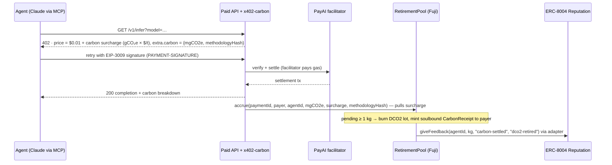

# DecarbonAI: carbon-metered x402 on Avalanche

Every paid agent call carries its own carbon. DecarbonAI is an x402 middleware for Avalanche: it estimates the gCO₂e of each AI call, folds a carbon surcharge into the same x402 payment, settles it into an on-chain **RetirementPool** on Avalanche Fuji, and once an agent has accrued 1 kg the pool retires credits, mints the agent a **soulbound receipt** (ERC-5192) and writes **"carbon-settled" feedback to its ERC-8004 reputation**. No human in the loop.

**Live web (v1 UI):** https://decarbonai.vercel.app

## Acknowledgments

Built for [Protocol Camp](https://www.protocolcamp.com) and Team1 Builders Demo Day (Bangkok, 28 Nov 2026).

**Group Member**
From Team1 Thailand

- [@ktsukixb](https://x.com/ktsukixb)
- [@101beere](https://x.com/101beere)

## How it works



1. **Meter.** `packages/core` estimates mgCO₂e from model + tokens (v0 factor set). The factor set is hashed (`METHODOLOGY_HASH`) and registered on-chain; every accrual carries it.
2. **Price.** `@decarbonai/x402-carbon` sets a dynamic x402 price: `base + ceil(mgCO₂e × pricePerTonne / 1e9)` (the pool's own `quote()` rounding), and puts the carbon terms in `PaymentRequirements.extra.carbon` so the payer sees them before signing.
3. **Settle.** An existing Fuji facilitator (PayAI, `https://facilitator.payai.network`, `eip155:43113`) verifies and settles the EIP-3009 transfer. Then the middleware's `CarbonMeter` (holds `METER_ROLE`) calls `RetirementPool.accrue`, which pulls the surcharge into the pool. `paymentId = keccak256(chainId, token, payer, eip3009Nonce)` is deduplicated on-chain.
4. **Retire.** Per payer account, every `thresholdMg` (1 kg) the pool burns that much DCO2, mints a soulbound `CarbonReceipt`, and (if the payer controls an ERC-8004 agent) writes reputation feedback through `ERC8004ReputationAdapter`. Up to 5 retirements happen inside one accrual; anyone can call `retire(payer)` for the rest.

## Deployed on Avalanche Fuji (chainId 43113)

All contracts are verified on Routescan/Snowtrace. Source of truth: [`deployments/fuji.json`](deployments/fuji.json).

| Contract | Address |
|---|---|
| RetirementPool | [`0x78186bd742263b0dfDAAAB0149991ef85803Eef0`](https://testnet.snowtrace.io/address/0x78186bd742263b0dfDAAAB0149991ef85803Eef0) |
| CarbonReceipt (ERC-721 + ERC-5192 soulbound) | [`0x17009c640325acc731D7C5a40C749BC91a186748`](https://testnet.snowtrace.io/address/0x17009c640325acc731D7C5a40C749BC91a186748) |
| DCO2 (ERC-1155, **testnet mock**) | [`0xC2802F1d5c8e32C6DaC94136686c22D2426Accf2`](https://testnet.snowtrace.io/address/0xC2802F1d5c8e32C6DaC94136686c22D2426Accf2) |
| ERC8004ReputationAdapter | [`0x3f672742dB74baEAD1716E81C82132d3d3F64CE9`](https://testnet.snowtrace.io/address/0x3f672742dB74baEAD1716E81C82132d3d3F64CE9) |
| TestUSDC (tUSDC, EIP-3009, faucet) | [`0xEe3aF37B5af84cDd20e7488F30Ea0b691bA20252`](https://testnet.snowtrace.io/address/0xEe3aF37B5af84cDd20e7488F30Ea0b691bA20252) |
| ERC-8004 ReputationRegistry (external) | [`0x8004B663056A597Dffe9eCcC1965A193B7388713`](https://testnet.snowtrace.io/address/0x8004B663056A597Dffe9eCcC1965A193B7388713) |
| ERC-8004 IdentityRegistry (external) | [`0x8004A818BFB912233c491871b3d84c89A494BD9e`](https://testnet.snowtrace.io/address/0x8004A818BFB912233c491871b3d84c89A494BD9e) |

Config: threshold 1 kg (`1_000_000` mg), price $25/t (`25_000_000` tUSDC units), methodology `v0-2026-08-anchored` = `0x50316f9e…e677`. Demo agent: `0x254E5C3cF3e6B90D14F6fC182F167764B8C183bB`, ERC-8004 agent **#360**.

Superseded: a first deployment (pool `0x4c6cccf978689B463749E8b0d97E69cC47fA7252`) labelled its DCO2 lot with a Carbonmark retirement. It was replaced by the mock-labelled deployment above and is **paused**.

### Credit supply: DCO2 is a testnet mock

**DCO2 on this deployment is not backed by a real tonne.** Its name is "DecarbonAI DCO2 (testnet mock, not backed by a real tonne)", symbol `mockDCO2`, and lot #1 is `registry: "MOCK (testnet, no registry)"`, `serial: DCAI-MOCK-FUJI-0001`. The contract keeps the custodial-bridge-v0 fields (registry, serial, vintage, project, retirement proof URI, one serial per lot) so a real retired tonne (e.g. Carbonmark / Verra / Thai T-VER) can be wired in later: the owner would retire the tonne off-chain and mint exactly that lot 1:1. The surcharge collected in the pool is what would pay for that tonne (`withdraw` by `TREASURY_ROLE`).

### Payment token

Circle's Fuji USDC (`0x5425…Bc65`) is only available from a captcha faucet, so the live path uses **TestUSDC**: a faucet ERC-20 with EIP-3009 `transferWithAuthorization`/`receiveWithAuthorization`. PayAI settles it on Fuji exactly like USDC (checked live). To switch to real USDC, deploy with `PAYMENT_TOKEN=0x5425890298aed601595a70AB815c96711a31Bc65` and pass `asset: { name: "USD Coin", version: "2" }` to the middleware.

## Repo layout

| Path | What |
|---|---|
| `packages/contracts` | Foundry project: `RetirementPool`, `CarbonReceipt`, `DCO2`, `ERC8004ReputationAdapter`, `TestUSDC`, deploy script, unit + fuzz tests. (`CertificateReceipt` is the v1 contract, kept for its existing deployment.) |
| `packages/core` | Emission factors (v0), per-call estimate, methodology hash. |
| `packages/chain` | ABIs, `deployments/fuji.json`, typed read helpers for the UI: `getPoolState`, `getAccount`, `getAgentBadge`, `getReceipt`, `getLot`, `listAccruals`, `listRetirements`. |
| `packages/x402-carbon` | Hono middleware `carbonPayment()`, `CarbonMeter`, pricing, and `createPayingFetch()` client. |
| `packages/mcp-server` | stdio MCP server for Claude: `paid_inference`, `carbon_status`, `estimate_carbon`. |
| `apps/paid-api` | Demo paid endpoint `GET /v1/infer` (simulated completion; the payment and carbon path are real). |
| `apps/web` | v1 Next.js UI (unchanged; redesign pending). `POST /api/offset` is now closed by default. |
| `scripts/` | `setup-agent.ts`, `demo-burst.ts`, `smoke-fuji.ts`, `gen-abis.mjs`. |

## Run it

```bash
npm ci
cp .env.example .env   # set FUJI_PRIVATE_KEY (deployer / meter) and AGENT_PRIVATE_KEY (any new key)
npm run setup:agent    # gas + 1000 tUSDC for the agent, registers its ERC-8004 identity -> add AGENT_ID to .env
npm run smoke:fuji     # pre-demo health check: wiring, roles, supply, facilitator, one real paid call
npm run demo:burst     # 100 paid calls, watch the pool fill and auto-retire (args: [calls] [concurrency])
```

Run the API and let Claude pay for itself:

```bash
npm run api            # http://localhost:4021, payTo = meter wallet
claude mcp add decarbonai -- node --env-file=$PWD/.env $PWD/packages/mcp-server/src/server.ts
# then ask Claude: "use paid_inference to ask reasoning-heavy about x402, then show carbon_status"
```

Contracts:

```bash
cd packages/contracts
forge test                               # 56 tests incl. fuzz, 100% line/branch coverage of src
forge coverage --report summary --no-match-coverage '(test|script)/'
# deploy (writes deployments/fuji.json); METHODOLOGY_HASH from packages/core
METHODOLOGY_HASH=0x50316f9e7beab6cf0a7448d957b7df5f08b46b2625cb05a270208de18de3e677 METHODOLOGY_VERSION=v0-2026-08-anchored \
PAYMENT_TOKEN=0xEe3aF37B5af84cDd20e7488F30Ea0b691bA20252 \
forge script script/Deploy.s.sol:Deploy --rpc-url $FUJI_RPC_URL --broadcast --verify \
  --verifier etherscan --verifier-url https://api.routescan.io/v2/network/testnet/evm/43113/etherscan --etherscan-api-key verifyContract
npm run contracts:abis                   # regenerate packages/chain/src/abis.ts
```

## Events the UI reads

| Contract | Event |
|---|---|
| RetirementPool | `CarbonAccrued(bytes32 indexed paymentId, address indexed payer, uint256 indexed agentId, uint256 mgCO2e, uint256 surcharge, bytes32 methodologyHash, uint256 pendingMg)` |
| RetirementPool | `Retired(uint256 indexed receiptId, address indexed payer, uint256 indexed agentId, uint256 lotId, uint256 mgCO2e, uint64 accrualCount)` |
| RetirementPool | `RetirementDeferred`, `AgentLinked`, `ReputationRecorded`, `ReputationFailed`, `MethodologySet`, `LotAdded`, `ThresholdSet`, `PriceSet`, `LimitsSet`, `ReputationSet`, `Withdrawn` |
| CarbonReceipt | `Transfer` (mint), `Locked(tokenId)` (ERC-5192); `retirement(id)` and on-chain `tokenURI` |
| DCO2 | `LotMinted`, `Retired(lotId, from, mgCO2e)`, `TransferSingle` |
| ERC8004ReputationAdapter | `CarbonFeedbackGiven(agentId, receiptId, mgCO2e)`; registry emits `NewFeedback` |
| TestUSDC | `AuthorizationUsed(payer, nonce)`: maps a `paymentId` to its x402 settlement tx |

The public Fuji RPC limits `eth_getLogs` to 100 blocks, so `packages/chain` reads logs from the Routescan API by default (`{ source: "rpc" }` to use a node).

## Known limits

- **DCO2 is a mock** (above). Receipts prove the settlement path, not a real-world retirement.
- **Trusted meter.** The pool cannot see the x402 transfer, so `METER_ROLE` is trusted to report honestly; `paymentId` dedupe stops double counting. Agent links are only made when the payer owns (or is the registered wallet of) the ERC-8004 agent.
- **Estimates are v0 factors** (`packages/core`), not EcoLogits yet, and are priced from declared `maxOutputTokens` before the call runs.
- **Simulated completion.** The demo API returns placeholder text; the payment, carbon accrual and retirement are real Fuji transactions.
- **In-memory meter queue.** If the API process dies between settlement and `accrue`, that accrual is lost (replays are safe thanks to dedupe). Early in testing 13 calls were under-accrued because PayAI batches settlements into one Multicall3 tx and the first `paymentId` was the tx hash; fixed by using the EIP-3009 nonce.
- **Surcharge at $25/t is tiny** (≈ $0.0006 for a 22 g call). That is the honest number; the business is volume and a take rate.

## v1 (legacy)

v1 retired Carbonmark credits on Base from a web checkout and mirrored a receipt to `CertificateReceipt` on Fuji ([`0x9dd6…7cc1`](https://testnet.snowtrace.io/address/0x9dd6ae803cab0bd07b4cbc09fab3bc30f7357cc1)). Its `POST /api/offset` spent real credits with no auth; it now returns 503 unless `OFFSET_ADMIN_TOKEN` is set server-side and sent as a Bearer token, and caps `tonnes` at 0.01. The local `.data` certificate store was removed.
